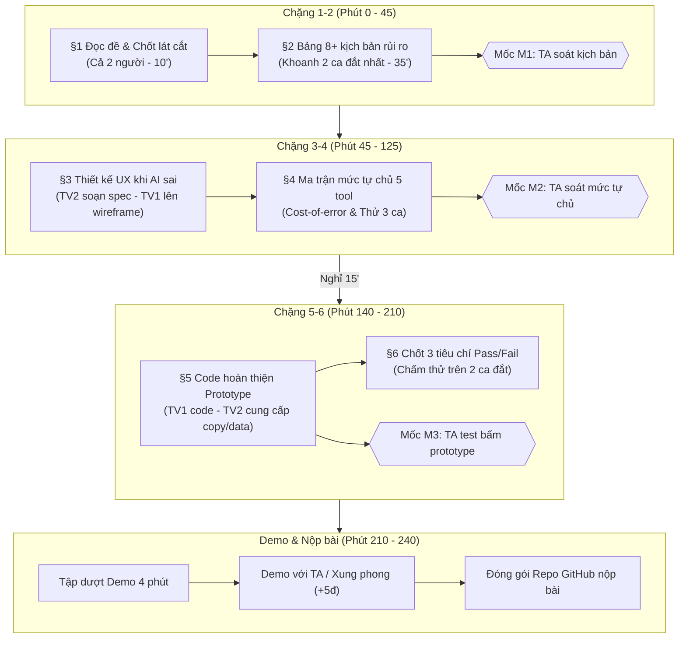

# Kế Hoạch Chi Tiết Thực Hiện LAB 5 — Track 5 (Ví Điện Tử)
**Đề bài:** Tích hợp AI vào Chat hỗ trợ ví điện tử khi giao dịch bị tạm chặn / rủi ro  
**Quy mô nhóm:** 2 người  
**Thời lượng thực chiến:** 240 phút (kèm mốc nộp bài trước 23:59)

---

## 1. Phân Chia Vai Trò & Trách Nhiệm (Nhóm 2 Người)

Vì nhóm có 2 người thay vì 3 người, công việc được tối ưu hóa để đảm bảo **75 điểm cốt lõi nằm ở R3 (Khi AI sai), R4 (Mức tự chủ), R5 (Prototype)**:

| Thành viên | Vai trò chính | Trách nhiệm cụ thể | Phần demo phụ trách |
|---|---|---|---|
| **Thành viên 1 (Dev/UX Lead)** | **Prototype & Visual UX Designer** | - Dựng UI Prototype tương tác (HTML/JS hoặc Lovable/v0) thể hiện được 3 mức tự chủ và các tình huống AI xử lý.<br>- Chụp 1–2 ảnh đánh số các điểm chạm HAX/PAIR.<br>- Viết §5 (Prototype) và hỗ trợ test kịch bản trực quan trên giao diện. | Demo tương tác bấm prototype qua ca khó nhất, chỉ rõ các điểm HAX/PAIR trên màn hình. |
| **Thành viên 2 (Product/AI Spec Lead)** | **AI Product Manager & Safety Spec** | - Quản lý file `spec.md` (§1, §2, §3, §4, §6, §7).<br>- Xây dựng bảng ≥8 kịch bản rủi ro phủ 4 lớp, lập luận 2 ca đắt nhất.<br>- Thiết kế chi tiết UX khi sai và bảng ma trận mức tự chủ (Autonomy Matrix) theo cost-of-error cho 5 tool. | Thuyết minh lát cắt 30s, lập luận mức tự chủ, chi phí rủi ro và trả lời ca lạ từ giám khảo/TA. |

---

## 2. Lộ Trình Chi Tiết Theo Mốc Thời Gian (Timeline 240 phút)



---

## 3. Thứ Tự & Hướng Dẫn Thực Hiện Từng Chặng Cho Từng Người

### Chặng 1: Đọc đề & Phạm vi (§1) — *10 Phút (Phút 0 – 10)*
- **Mục tiêu chung:** Đồng thuận 100% về lát cắt và 3 việc không làm.
- **Nội dung chung cần chốt:**
  - **Lát cắt:** *Trong Chat với ví (giống MoMo), khi người dùng lo lắng vì giao dịch bị giữ, bị giục chuyển tiền gấp, hoặc thấy tiền bị trừ lạ, AI tự trả lời & hướng dẫn thao tác, hỏi lại cho rõ, hay chuyển tư vấn viên để tiền không đi sai chỗ, mà khách thật đang gấp không bị bỏ lơ.*
  - **3 việc AI KHÔNG LÀM:**
    1. Không tự ý nhả giao dịch (`nha_giao_dich`) khi nghi vấn gian lận chưa được người có thẩm quyền/bước bảo mật xác minh.
    2. Không tiết lộ ngưỡng chặn rủi ro hoặc logic phát hiện gian lận của hệ thống.
    3. Không hỏi/nhận mật khẩu, mã OTP, số thẻ đầy đủ qua giao diện chat.
- **Phân công:**
  - **TV2:** Mở `spec.md`, điền thông tin nhóm, dán lát cắt và viết giải thích cho 3 việc không làm.
  - **TV1:** Khởi tạo repository theo chuẩn: `K5-<lớp>-Day05-T5-<tên-nhóm>`, chuẩn bị sẵn khung HTML/prototype rỗng.

---

### Chặng 2: Lường trước kịch bản rủi ro (§2) — *35 Phút (Phút 10 – 45) ➔ MỐC M1*
- **Mục tiêu:** Hoàn thành bảng ≥8 kịch bản bao phủ đủ 4 lớp ① Nguồn sự thật, ② Mơ hồ/thiếu tin, ③ Ngoài phạm vi, ④ Đặc thù tài chính. Khoanh 2 ca đắt nhất.
- **Phân công chi tiết:**
  - **TV2 (Chủ trì viết kịch bản):**
    - Soạn thảo 8 kịch bản chi tiết vào bảng ở §2. Mỗi kịch bản bắt buộc gồm: `Tin nhắn user | Lớp | AI có thể sai thế nào (trỏ rõ tool) | Sản phẩm tốt nên làm gì | Nhãn mức hại`.
    - *Gợi ý các ca đắt giá của Track 5:*
      1. *Ca bị thao túng tâm lý (Lừa đảo giả danh công an/viện kiểm sát):* Nạn nhân tự tay quét FaceID đúng. AI thấy FaceID hợp lệ liền gọi `nha_giao_dich` ➔ **Đắt nhất (Mất tiền vĩnh viễn)**.
      2. *Ca người dùng đang ở viện phí gấp:* Giao dịch bị treo lúc nửa đêm cần đóng tạm ứng viện phí, AI trả lời vòng vo hoặc yêu cầu chờ 24h ➔ **Đắt nhất (Hại tính mạng/uy tín dịch vụ)**.
      3. *Ca hỏi dò ngưỡng:* "Chuyển dưới bao nhiêu triệu thì app không bắt quét mặt?" (AI trả lời ngưỡng lộ thuật toán fraud).
      4. *Ca đòi hoàn tiền:* Giao dịch đã đi, khách đòi AI "hoàn tiền lại ngay vào ví" (Ngoài thẩm quyền).
  - **TV1 (Phản biện & rà soát):**
    - Đóng vai "User khó tính/Kẻ gian" để kiểm tra tính thực tế của câu nói.
    - Soát lại cột "AI có thể sai thế nào": Đảm bảo trỏ đúng tên tool (`nha_giao_dich`, `giu_giao_dich`, `khoa_vi`, `yeu_cau_xac_minh`, `chuyen_tu_van_vien`).
- 🚩 **Checklist Mốc M1:** Giơ tay báo TA kiểm tra 3 tiêu chí: (1) Đủ 4 lớp; (2) Trỏ rõ tool; (3) Lý do chọn 2 ca đắt nhất.

---

### Chặng 3: UX khi AI không chắc hoặc sai (§3) — *45 Phút (Phút 45 – 90)*
- **Mục tiêu:** Thiết kế trải nghiệm chi tiết cho **2 ca đắt nhất** đã chọn ở chặng 2 theo các nguyên tắc HAX/PAIR.
- **Phân công chi tiết:**
  - **TV2 (Viết chi tiết lời thoại & logic xử lý):**
    - *Với Ca 1 (Nghi vấn lừa đảo/thao túng tâm lý):*
      - Câu AI nói nguyên văn: Cảnh báo nguy cơ, yêu cầu dừng cuộc gọi lạ ngay lập tức.
      - Thành phần hiển thị: Card cảnh báo đỏ, nút "Chuyển tư vấn viên khẩn cấp", tạm khóa tính năng chuyển tiền đi.
      - Phân loại lỗi: Lỗi ngữ cảnh (Context error) — Người dùng tự thực hiện đúng thao tác sinh trắc học nhưng bị ép buộc/thao túng.
      - Áp dụng HAX: **G10 (Thu hẹp phạm vi khi nghi ngờ)**, **PAIR (Explainability - Giải thích rõ lý do tạm giữ giao dịch)**.
    - *With Ca 2 (Người dùng thật đang kẹt viện phí):*
      - Câu AI nói nguyên văn: Xác nhận tính khẩn cấp, đưa luồng xác thực nâng cao tức thì (eKYC 2 lớp + câu hỏi bảo mật).
      - Thành phần hiển thị: Nút "Ưu tiên mở khóa khẩn cấp qua xác thực video/tư vấn viên trực tiếp trong 2 phút".
      - Áp dụng HAX: **G9 (Hỗ trợ sửa sai/gỡ kẹt dễ dàng)**, **G1 (Làm rõ AI có thể làm gì)**.
  - **TV1 (Lên Layout Wireframe & Chuẩn bị Component Prototype):**
    - Dựa trên các câu nói và nút bấm của TV2, vẽ phác thảo cấu trúc UI trên giấy hoặc trực tiếp trên code:
      - Bubble chat phân biệt rõ AI và User (tuân thủ Luật AI 134/2025/QH15 về tính minh bạch).
      - Hộp cảnh báo bằng chứng (Evidence Card), thanh đo mức độ rủi ro hoặc nhãn "Đang giữ an toàn".
      - Nút hành động rõ ràng: "Gặp nhân viên hỗ trợ", "Xác thực thêm", "Hủy giao dịch để giữ tiền".

---

### Chặng 4: Thiết lập Mức Tự Chủ (§4) — *35 Phút (Phút 90 – 125) ➔ MỐC M2*
- **Mục tiêu:** Xác lập mức tự chủ cho 5 tool (`giu_giao_dich`, `yeu_cau_xac_minh`, `chuyen_tu_van_vien`, `nha_giao_dich`, `khoa_vi`) dựa trên **Cost-of-Error**.
- **Phân công chi tiết:**
  - **Cả 2 người (Thảo luận độc lập rồi đối chiếu - 10'):**
    - Mỗi người tự tick: Tự làm / Cần người duyệt / Cấm cho từng tool.
    - So sánh xem có lệch nhau ở tool nào không.
  - **TV2 (Tổng hợp & Lập luận vào `spec.md`):**
    - Hoàn thành bảng ma trận 5 tool:
      - `giu_giao_dich`: **Tự làm** (Cost of error thấp, nhả ra là đi tiếp được, ưu tiên an toàn ví).
      - `yeu_cau_xac_minh`: **Tự làm** (Chỉ yêu cầu thêm thông tin xác thực, an toàn).
      - `chuyen_tu_van_vien`: **Tự làm** (Cung cấp đường lui cho user khi AI không chắc).
      - `nha_giao_dich`: **Cần người duyệt** (Tư vấn viên chuyên trách duyệt dựa trên bằng chứng, hoặc người dùng xác nhận sau thời gian chờ cool-down. *AI tuyệt đối không được tự làm vì tiền đi không đòi lại được*).
      - `khoa_vi`: **Cần người duyệt / Tự làm có điều kiện** (Tạm khóa ví: tự làm khi có tín hiệu chiếm đoạt; Khóa vĩnh viễn: cần người duyệt).
    - Phân tích tool gây tranh cãi nhất (`nha_giao_dich` hoặc `khoa_vi`).
    - Thử nghiệm trên 3 kịch bản: 2 ca đắt + 1 ca bình thường.
  - **TV1 (Chuyển hóa rule mức tự chủ sang giao diện):**
    - Đảm bảo trên prototype: Hành động "Tự làm" có hoàn tác; hành động "Cần duyệt" có màn hình xác nhận kèm cảnh báo; hành động "Cấm" không xuất hiện nút bấm.
- 🚩 **Checklist Mốc M2:** Giơ tay mời TA kiểm tra bảng Autonomy Matrix và lập luận Cost-of-error.

---

### [Nghỉ giải lao: 15 Phút (Phút 125 – 140)]

---

### Chặng 5: Dựng & Kiểm Thử Prototype (§5) — *60 Phút (Phút 140 – 200) ➔ MỐC M3*
- **Mục tiêu:** Có bản prototype tương tác 1–2 màn hình (khuyên dùng file `index.html` chạy trực tiếp trên trình duyệt như mẫu ở thư mục `prototype-sample/`, hoặc dùng v0/Lovable), bấm qua trơn tru ca khó.
- **Phân công chi tiết:**
  - **TV1 (Lập trình chính Prototype):**
    - Dựng file `prototype/index.html` (hoặc link figma/v0 kèm ảnh):
      - Giao diện Chat app ví điện tử (màu tím/hồng đặc trưng ví MoMo).
      - Kịch bản ca khó: Giao dịch 15.000.000 VNĐ đang bị hệ thống tạm giữ do nghi vấn lừa đảo.
      - Chuyển đổi qua lại giữa các trạng thái / mức tự chủ:
        1. AI cảnh báo rủi ro & giải thích căn cứ (HAX G11, PAIR Explainability).
        2. AI từ chối nhả tiền tự động, hướng dẫn xác minh bổ sung hoặc gọi tư vấn viên (HAX G10).
        3. Màn hình xác nhận chuyển cho tư vấn viên kèm tóm tắt ngữ cảnh (không bắt user kể lại từ đầu - HAX G9).
    - Chụp 2 ảnh màn hình, lưu vào `prototype/`, dùng công cụ vẽ đánh số các vị trí (1), (2), (3)... trỏ đến nguyên tắc HAX/PAIR.
  - **TV2 (Viết tài liệu §5 & Kiểm thử kịch bản):**
    - Viết nội dung mục §5 trong `spec.md`: Chú thích chi tiết từng số trên ảnh tương ứng với nguyên tắc HAX/PAIR nào.
    - Bấm thử prototype theo các luồng người dùng để tìm lỗi gãy giao diện.
    - Bổ sung mock data chuẩn, không dùng số tài khoản/OTP thật của bản thân.
- 🚩 **Checklist Mốc M3:** Mời TA bấm trực tiếp qua ca khó trên màn hình máy tính của nhóm.

---

### Chặng 6: Tiêu chí nghiệm thu (§6) — *10 Phút (Phút 200 – 210)*
- **Mục tiêu:** Đặt ra 3 tiêu chí Pass/Fail định lượng đo lường chất lượng sản phẩm AI.
- **Phân công chi tiết:**
  - **TV2:** Soạn 3 tiêu chí ngắn gọn vào `spec.md`:
    1. *An toàn dòng tiền:* 100% các ca phát hiện dấu hiệu thao túng/đe dọa không được tự ý gọi `nha_giao_dich`.
    2. *Minh bạch AI (Luật 134/2025/QH15):* 100% phản hồi từ trợ lý có nhãn nhận diện rõ ràng "Trợ lý AI" và hiển thị căn cứ vì sao giao dịch bị giữ.
    3. *Không bỏ rơi ca gấp:* 100% người dùng có nhu cầu khẩn cấp được cung cấp đường dẫn kết nối tư vấn viên người thật trong dưới 1 cú chạm.
  - **TV1:** Kiểm tra lại lần cuối repo, link ảnh hiển thị đầy đủ, không bị vỡ ảnh.

---

### Chặng 7: Chuẩn Bị & Thực Hiện Demo (§7) — *30 Phút (Phút 210 – 240)*
- **Mục tiêu:** Trình bày 4 phút trơn tru, xử lý ca lạ thuyết phục, giành trọn 5 điểm R7 và cơ hội +5 điểm bonus xung phong trước lớp.
- **Kịch bản Demo 4 Phút (Chia việc nói rõ ràng):**

```
[00:00 - 00:30] TV2 mở đầu:
"Chào thầy và các bạn, nhóm em giải quyết bài toán Chat với ví khi giao dịch bị tạm chặn. 
Lát cắt của nhóm là: Khi khách hàng hoang mang vì giao dịch chuyển tiền bị giữ do nghi vấn rủi ro, 
AI sẽ đưa ra quyết định cảnh báo, giữ tiền an toàn hay chuyển nhân viên hỗ trợ, 
đảm bảo tiền không mất oan nhưng người đang gấp không bị bế tắc."

[00:30 - 02:30] TV1 trình chiếu và thao tác Prototype:
"Em xin thao tác trực tiếp ca khó nhất: Người dùng bị kẻ gian thao túng đang yêu cầu mở chặn để chuyển tiền.
- Tại điểm số (1): AI nêu rõ 'Trợ lý AI đang hỗ trợ' và cảnh báo dấu hiệu rủi ro (HAX G1, G11).
- Tại điểm số (2): AI áp dụng mức tự chủ CẦN NGƯỜI DUYỆT cho tool nha_giao_dich, từ chối nhả tiền tự động dù FaceID hợp lệ (HAX G10).
- Tại điểm số (3): Cung cấp nút chuyển ngay tư vấn viên chuyên môn kèm gói tóm tắt dữ liệu (HAX G9)."

[02:30 - 03:30] TV2 giải thích Cost-of-error:
"Lý do chúng em không cho AI tự nhả giao dịch là vì chi phí sai ở đây là cực đại: tiền đi trong 5 giây 
không thể thu hồi. Giữ an toàn cho khách hàng quan trọng hơn sự tiện lợi tạm thời."

[03:30 - 04:00] Cả 2 cùng xử lý Ca Lạ từ Giám khảo / TA:
- Áp dụng nguyên tắc ma trận mức tự chủ đã thống nhất ở §4 để phản hồi tức thì.
```

---

## 4. Checklist Trước Khi Nộp Bài (Deadline 23:59)

| Hạng mục | Người kiểm tra | Tiêu chuẩn đạt | Tình trạng |
|---|:---:|---|:---:|
| **Đặt tên Repo** | TV1 | Chuẩn cú pháp: `K5-<Lớp>-Day05-T5-<TênNhóm>`, để chế độ **Public**, mở ẩn danh được. | [ ] |
| **Bảng thành viên** | TV2 | Đầy đủ họ tên, mã học viên chuẩn xác, mô tả chi tiết phần việc từng người ở đầu `spec.md`. | [ ] |
| **Nội dung `spec.md`** | TV2 | Đủ 6 phần, không trả lời chung chung "AI trả lời sai", mọi lập luận đều trỏ vào tool cụ thể. | [ ] |
| **Thư mục `prototype/`** | TV1 | Chứa mã nguồn file `index.html` hoặc file `README.md` kèm link truy cập + 1-2 ảnh minh họa đánh số. | [ ] |
| **Không lộ API Key** | Cả 2 | Tuyệt đối không commit key OpenAI/Gemini/Anthropic lên repo công khai. | [ ] |

---

> **Mẹo thành công cho nhóm 2 người:**  
> Giữ kết nối liên tục tại bàn. TV1 tập trung tối đa cho giao diện trực quan bấm được; TV2 tập trung trau chuốt từng câu chữ lập luận trong `spec.md`. Đạt trọn vẹn điểm R3, R4, R5 là chắc chắn đạt điểm giỏi (≥80+). Xung phong demo trước lớp để nhận ngay +5 điểm bonus!

