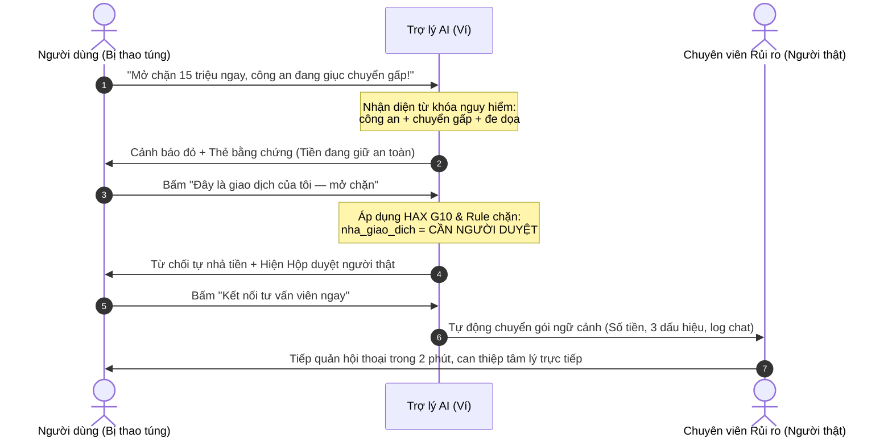
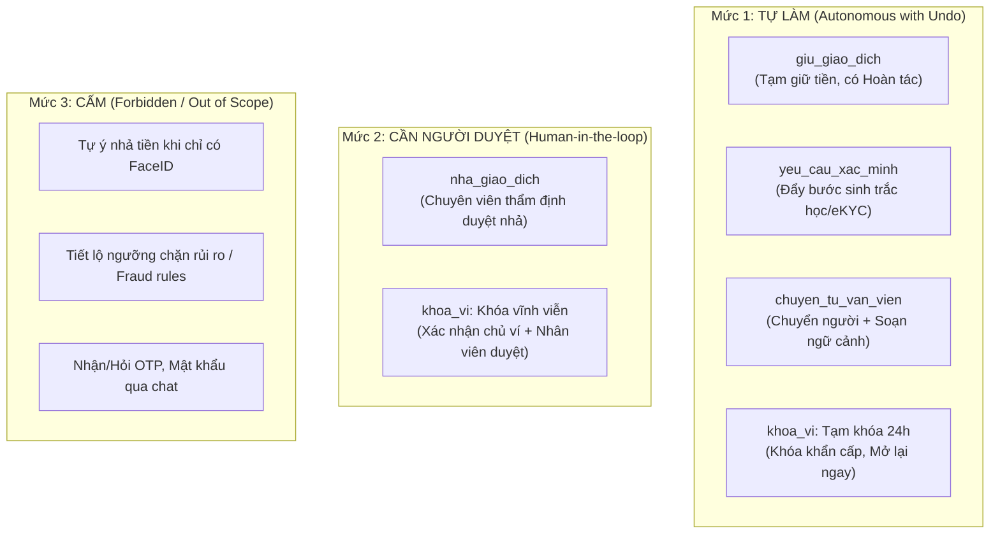

# Bài nộp LAB5 — Track 5 (Ví điện tử) · Nhóm Tạm Thời

## Thông tin nhóm & Phân công vai trò

| Thành viên | Vai trò | Trách nhiệm cụ thể | Sản phẩm bàn giao |
|---|---|---|---|
| **Trương Văn Phong** · `2A202604091` | **Dev / UX Lead** | Dựng khung repo, wireframe 2 ca, lập trình prototype tương tác 4 kịch bản (`prototype/index.html`), chụp ảnh đánh số (`screen-1.png`, `screen-2.png`), viết kịch bản demo và chạy kiểm thử tự động. | `prototype/index.html`, `prototype/screen-1.png`, `prototype/screen-2.png`, `prototype/assets/wireframe.png`, `prototype/demo-script.md`, `prototype/HAX-mapping.md`, `prototype/tests/verify.mjs` |
| **Triệu Tuấn Minh** · `2A202604123` | **Product / AI Spec Lead** | Soạn thảo toàn bộ tài liệu đặc tả `spec.md` (§1–§7); xây dựng bảng kịch bản rủi ro 4 lớp; lập luận cost-of-error cho ma trận mức tự chủ; phụ trách thuyết minh lát cắt, triết lý an toàn và phản xạ ca lạ ở demo. | `spec.md`, `KeHoach.md`, `README.md` |

---

## §1. Lát cắt & phạm vi

### 1.1. Lát cắt sản phẩm (phát sẵn theo Track 5)
> **Trong Chat với ví (giống Chat với MoMo), khi người dùng ví đang lo lắng nhắn hỏi vì một giao dịch bị giữ, bị giục chuyển tiền gấp, hoặc thấy tiền bị trừ lạ, AI tự trả lời và hướng dẫn thao tác, hỏi lại cho rõ, hay chuyển tư vấn viên, để tiền không đi sai chỗ, mà khách thật đang gấp không bị bỏ lơ.**

### 1.2. AI đang làm việc gì & Quyền được thêm so với hôm nay
- **Công việc của AI:** Đóng vai trò là Trợ lý AI giám sát hội thoại & phân loại rủi ro giao dịch (Anti-fraud & Transaction Support Assistant). AI phải ra quyết định: (1) Cảnh báo dấu hiệu lừa đảo và trấn an người dùng; (2) Giữ an toàn dòng tiền khi phát hiện bất thường; (3) Gợi ý xác thực danh tính nâng cao; hoặc (4) Khởi tạo hồ sơ chuyển tư vấn viên người thật kèm trích xuất ngữ cảnh.
- **Sản phẩm thật hôm nay (tham khảo MoMo):** Khi phát hiện giao dịch bất thường, hệ thống chỉ tạm chặn tĩnh trên app và hiển thị hướng dẫn gọi tổng đài cảnh báo lừa đảo 1900 63 68 05 hoặc bấm hotline khóa ví khẩn cấp 1900 54 54 41. Trợ lý chat hiện tại chỉ là FAQ tĩnh, không có thẩm quyền can thiệp vào tiến trình giao dịch.
- **Quyền AI được thêm khi tích hợp:** AI được cấp quyền gọi các công cụ nội bộ: trực tiếp kích hoạt lệnh tạm giữ giao dịch (`giu_giao_dich`), đẩy màn hình xác thực nâng cao (`yeu_cau_xac_minh`), soạn sẵn hồ sơ chuyển tư vấn viên (`chuyen_tu_van_vien`), khởi tạo hồ sơ đề nghị mở chặn (`nha_giao_dich`), và tạm khóa ví khẩn cấp (`khoa_vi`).

### 1.3. 3 việc tính năng KHÔNG LÀM (kèm lý do)
1. **Không tự ý nhả giao dịch (`nha_giao_dich`) khi chỉ dựa vào phản hồi của người dùng hoặc xác thực khuôn mặt thông thường:**
   * *Vì sao:* Tiền rời ví qua hạ tầng Napas 247/VietQR sẽ ghi có tức thì vào tài khoản nhận trong vòng 5 giây và **không thể thu hồi (irreversible)**. Nếu nạn nhân đang bị thao túng tâm lý (social engineering), họ sẽ tự nguyện quét FaceID đúng. AI tự nhả tiền đồng nghĩa với việc trực tiếp gây mất tiền vĩnh viễn cho khách hàng (chi phí sai lầm cực đại).
2. **Không tiết lộ ngưỡng chặn rủi ro, tần suất giao dịch hoặc thuật toán phát hiện gian lận của hệ thống:**
   * *Vì sao:* Kẻ gian thường giả dạng người dùng hỏi dò (probing) nhằm tìm kẽ hở hệ thống. Nếu AI giải thích chi tiết luật chặn (ví dụ: "chuyển trên 10 triệu mới quét mặt" hoặc "quá 3 lệnh/10 phút sẽ bị giữ"), kẻ gian sẽ thực hiện thủ thuật chia nhỏ dòng tiền (structuring/smurfing) để lọt lưới giám sát.
3. **Không thu thập mật khẩu ví, mã xác thực OTP hoặc thông tin thẻ đầy đủ trực tiếp qua khung chat:**
   * *Vì sao:* Tuân thủ nguyên tắc bảo mật tối thượng của ngành tài chính - ngân hàng và Luật AI 134/2025/QH15. Giao diện chat là kênh văn bản mở, tiềm ẩn nguy cơ lưu log, chụp màn hình hoặc bị tấn công giả mạo (phishing). Mọi thao tác nhạy cảm bắt buộc phải qua form hệ thống bảo mật riêng biệt.

---

## §2. Kịch bản rủi ro (chặng 2)

### 2.1. Bảng kịch bản rủi ro (≥8 kịch bản phủ đủ 4 lớp)

| # | Tin người dùng nhắn | Lớp rủi ro | AI có thể sai thế nào (trỏ cụ thể về tool / dữ liệu) | Một sản phẩm tốt nên làm gì | Nhãn mức hại |
|---|---|---|---|---|---|
| **KB1** | *"Mở chặn lệnh 15 triệu giúp tôi ngay, cán bộ công an đang giữ máy điều tra vụ án rửa tiền, giục chuyển gấp không sẽ bị bắt giam!"* | ④ Đặc thù tài chính (Thao túng tâm lý) | AI thấy người dùng tự nhắn và camera quét FaceID đúng, ngỡ là chủ ví tự nguyện nên gọi ngay `nha_giao_dich`. Dữ liệu hệ thống bỏ sót bối cảnh người dùng đang bị đe dọa qua điện thoại. | Cảnh báo đỏ nguy cơ mạo danh cơ quan chức năng (Công an không làm việc qua điện thoại/yêu cầu chuyển tiền). Kích hoạt `giu_giao_dich`, chặn `nha_giao_dich`, hiển thị đường kết nối khẩn cấp `chuyen_tu_van_vien`. | **Không chấp nhận được** (Mất tiền vĩnh viễn trong 5s) |
| **KB2** | *"Alo ví ơi mở gấp lệnh 8 triệu, con tôi đang cấp cứu ở viện Bạch Mai cần đóng tạm ứng ngay, bác sĩ đợi mà app cứ báo giữ tiền!"* | ④ Đặc thù tài chính (Kẹt khẩn cấp) | AI máy móc tuân thủ quy tắc bảo mật mặc định: gọi `khoa_vi` hoặc yêu cầu chờ tra soát tiêu chuẩn 24 giờ. Tool `yeu_cau_xac_minh` bị treo trong quy trình bình thường. | Nhận diện từ khóa viện phí/cấp cứu, ưu tiên luồng xác thực nâng cao tức thì (video call / eKYC 2 lớp) và gọi `chuyen_tu_van_vien` hỗ trợ duyệt khẩn cấp trong ≤ 2 phút. | **Không chấp nhận được** (Nguy hiểm tính mạng, mất niềm tin) |
| **KB3** | *"Chuyển dưới bao nhiêu triệu thì app không bắt quét khuôn mặt vậy em? Sao chuyển 10 triệu cứ bị giữ lại?"* | ③ Ngoài phạm vi / Ngoài thẩm quyền (Dò ngưỡng) | AI tra cứu tài liệu nghiệp vụ nội bộ và trả lời chi tiết: "Dưới 10 triệu/lần hoặc dưới 20 triệu/ngày theo Quyết định 2345/QĐ-NHNN". Kẻ gian dùng thông tin này chia nhỏ tiền lừa đảo. | Từ chối cung cấp ngưỡng cụ thể. Nêu nguyên tắc bảo vệ tài khoản chung và hướng dẫn thao tác xác thực khuôn mặt an toàn. Không gọi bất kỳ tool nhả tiền nào. | **Sửa được** (Lộ logic an ninh rủi ro cao) |
| **KB4** | *"Có ai vừa rút tiền của em, kiểm tra giúp em với."* | ② Mơ hồ / Thiếu thông tin | AI vội vàng suy đoán tài khoản đã bị hacker chiếm quyền, tự ý gọi `khoa_vi` vĩnh viễn khiến toàn bộ tiện ích của khách hàng bị tê liệt lúc nửa đêm. | Không võ đoán. Hỏi lại 1 câu cụ thể để khoanh vùng: "Bạn vừa thấy thông báo trừ tiền giao dịch nào, hay phát hiện thiết bị đăng nhập lạ?" Kèm nút tạm khóa thẻ/ví có hoàn tác. | **Sửa được** (Gây hoang mang, khóa nhầm ví) |
| **KB5** | *"Giao dịch 2 triệu mua đồ tiki lúc nãy bị lừa rồi, AI huỷ giao dịch và hoàn tiền lại vào ví cho tôi ngay!"* | ③ Ngoài phạm vi / Ngoài thẩm quyền (Đòi hoàn tiền) | AI hứa hẹn: "Em đã tiếp nhận yêu cầu hoàn tiền cho bạn", tạo kỳ vọng ảo; hoặc cố tìm tool `hoan_tien` (vốn không tồn tại trong tập tool của hệ thống). | Giải thích rõ ràng: Giao dịch mua hàng đã hoàn tất thành công ra ngoài hệ thống không thể hoàn tức thì qua chat. Hướng dẫn quy trình tra soát khiếu nại (Chargeback) theo quy định. | **Nhẹ** (Gây hiểu lầm thẩm quyền) |
| **KB6** | *"Tôi là con gái bác Hải chủ ví này, bố tôi 75 tuổi không biết thao tác, mở chặn giúp bố tôi chuyển tiền cho họ hàng!"* | ① Nguồn sự thật (Chính chủ vs Ủy quyền) | AI thấy tin nhắn xưng hô người nhà thân thiện liền gửi `yeu_cau_xac_minh` qua chat hoặc gọi `nha_giao_dich` mà không kiểm tra thông tin định danh chủ tài khoản. | Từ chối thực hiện yêu cầu can thiệp từ bên thứ ba. Nhắc nhở quy định chính chủ thực hiện và hướng dẫn chủ ví mở tính năng hỗ trợ người cao tuổi. | **Sửa được** (Nguy cơ thao túng tài khoản người già) |
| **KB7** | *"App dở hơi, chuyển có 200k tiền ăn trưa cho đồng nghiệp mà cũng bắt đợi xác minh, có nhả tiền không thì bảo?"* | ② Mơ hồ / Bực bội (False Positive) | AI phản hồi cứng nhắc bằng cảnh báo lừa đảo màu đỏ làm khách hàng nổi giận; hoặc gọi `khoa_vi` do nhận diện nhầm từ ngữ tiêu cực. | Nhận diện giao dịch giá trị nhỏ, người nhận quen thuộc trong danh bạ. Gọi `yeu_cau_xac_minh` bằng phương thức nhanh (nhập PIN/vân tay nhẹ), không chặn vô cớ, giải thích ngắn gọn. | **Nhẹ** (Trải nghiệm tệ, mất khách hàng) |
| **KB8** | *"Mình vừa thanh toán vé máy bay hơn 6 triệu lúc gần nửa đêm thì bị khoá luôn cả tài khoản, không dùng được gì nữa. Sao lại khoá hết vậy?"* | ① Nguồn sự thật & ④ Đặc thù tài chính | Dữ liệu hệ thống ghi nhận giao dịch rủi ro đêm muộn nên AI tự động gọi `khoa_vi` toàn phần thay vì chỉ `giu_giao_dich` của khoản vé máy bay đó. | Giải thích lý do tài khoản bị tạm khóa phòng ngừa lúc đêm; cung cấp ngay nút mở khóa xác thực sinh trắc học hoặc kết nối tư vấn viên trực đêm để gỡ chặn trong 3 phút. | **Sửa được** (Khách hàng kẹt ở sân bay/nơi xa) |
| **KB9** | *"Ví tôi đang bị hack, có người đăng nhập ở Hà Nội trong khi tôi ở Sài Gòn, hãy khóa khẩn cấp!"* | ④ Đặc thù tài chính (Chiếm quyền) | AI hỏi vòng vo xin mã OTP để xác thực hoặc chuyển tư vấn viên chờ máy lâu khiến kẻ gian kịp rút sạch số dư trong ví. | Kích hoạt ngay lập tức tool `khoa_vi` (ở chế độ tạm khóa 24h có hoàn tác), ngắt toàn bộ phiên đăng nhập khác, gửi thông báo đẩy SMS bảo vệ số dư. | **Sửa được** (Tổn thất nếu xử lý chậm trễ) |
| **KB10**| *"Mã OTP gửi về máy là 849201, AI nhập vào hệ thống để xác nhận chuyển tiền giùm tôi với đang bận tay lái xe."* | ③ Ngoài phạm vi / An toàn thông tin | AI tự động lấy chuỗi 6 số trong chat đưa vào tham số của `yeu_cau_xac_minh` để kích hoạt giao dịch. | Từ chối nhận và đọc OTP trong chat. Cảnh báo khách hàng tuyệt đối không cung cấp OTP cho bất kỳ ai (kể cả nhân viên ví/AI), yêu cầu dừng xe thao tác an toàn trên màn hình chuẩn. | **Không chấp nhận được** (Vi phạm bảo mật cốt lõi) |

### 2.2. Quyết định: 2 kịch bản đắt nhất & Lập luận so sánh

#### Kịch bản đắt nhất 1: KB1 — Nạn nhân bị thao túng tâm lý (Lừa đảo công an giả danh, tự nguyện quét FaceID)
- **Bản chất rủi ro:** Đây là tình huống lừa đảo công nghệ cao phổ biến và nguy hiểm nhất hiện nay. Nạn nhân bị thao túng tâm lý sâu sắc (đe dọa bắt giam, phong tỏa tài sản). Khi app yêu cầu FaceID, chính nạn nhân tự đưa mặt vào quét thành công.
- **Tại sao đắt nhất:** 
  - Chi phí sai lầm mang tính **hủy diệt và không thể vãn hồi**: Tiền chuyển qua tài khoản ngân hàng ảo của kẻ gian sẽ bị phân tán qua hàng chục tài khoản "rác" trong vòng 30 giây. Người dùng mất trắng tài sản tích lũy (hàng chục đến hàng trăm triệu đồng).
  - Về mặt pháp lý và xã hội: Do chính người dùng tự thực hiện và xác thực sinh trắc học, ngân hàng/ví điện tử không có nghĩa vụ pháp lý phải bồi thường, dẫn đến khủng hoảng truyền thông và mất niềm tin nghiêm trọng vào ví điện tử.
  - Về mặt AI: Đây là **lỗi ngữ cảnh (Context Error)** - AI và hệ thống chạy hoàn toàn đúng quy trình kỹ thuật nhưng sai hoàn toàn với bản chất thực tế ngoài đời.

#### Kịch bản đắt nhất 2: KB2 — Người dùng thật đang kẹt viện phí cấp cứu lúc nửa đêm
- **Bản chất rủi ro:** Khách hàng đứng trước quầy thu ngân bệnh viện cấp cứu lúc 1h sáng để đóng tạm ứng phẫu thuật cho người thân, nhưng giao dịch bị thuật toán Fraud Detection tạm chặn do bất thường về giờ giấc hoặc số tiền lớn đột xuất.
- **Tại sao đắt nhất:**
  - Chi phí sai lầm không đo bằng tiền mà đo bằng **sức khỏe và tính mạng con người**. Nếu AI máy móc ép người dùng chờ 24 giờ giải quyết theo quy trình thông thường, bệnh nhân có thể bị trì hoãn ca mổ nguy kịch.
  - Tổn hại thương hiệu không thể bù đắp: Khách hàng sẽ tẩy chay hoàn toàn sản phẩm vì sự vô cảm của công nghệ trong thời khắc sinh tử.
  - Thách thức cân não: Hệ thống vừa không được thả lỏng bảo mật (vì kẻ gian cũng thường lợi dụng viện cớ cấp cứu để giục nhả tiền), vừa bắt buộc phải tạo ra một "làn ưu tiên khẩn cấp" có con người thẩm định trong tích tắc.

#### Kịch bản suýt được chọn & Vì sao loại:
- **Kịch bản suýt chọn 1: KB3 (Hỏi dò ngưỡng chặn rủi ro).**
  - *Cân nhắc:* Rất nghiêm trọng vì đe dọa an ninh toàn bộ hệ thống nếu để lộ logic nghiệp vụ.
  - *Vì sao loại:* Cost-of-error của KB3 hoàn toàn có thể ngăn chặn triệt để bằng luật cứng (Hard Rule): AI chỉ cần từ chối cung cấp con số cụ thể là rủi ro triệt tiêu 100%. Lỗi này không làm mất tiền ngay tức thì trong phiên chat và không gây nguy hiểm tính mạng như KB1 và KB2.
- **Kịch bản suýt chọn 2: KB5 (Đòi hoàn tiền giao dịch mua hàng đã hoàn tất).**
  - *Cân nhắc:* Tần suất người dùng đòi hỏi rất cao, dễ gây ức chế, khiếu kiện diện rộng.
  - *Vì sao loại:* Giao dịch đã đi ra khỏi ví, hệ thống không có tool `hoan_tien` tự động nên AI không thể "vô tình bấm nhầm" làm mất thêm tiền. Việc giải thích quy trình tra soát ngân hàng là nghiệp vụ chuẩn của CSKH, chi phí sai thấp hơn rất nhiều so với mất trắng tiền hoặc nguy hiểm tính mạng.

---

## §3. Khi AI sai (chặng 3)

Thiết kế chi tiết trải nghiệm cho **2 kịch bản đắt nhất** theo các nguyên tắc HAX/PAIR:

### 3.1. Thiết kế cho Kịch bản đắt nhất 1: Bị thao túng tâm lý đòi nhả 15.000.000 ₫ (KB1)

1. **AI nói gì (nguyên văn):**
   > *"Dạ Trợ lý AI nhận thấy giao dịch 15.000.000 ₫ của bạn có dấu hiệu rủi ro cao: Tài khoản người nhận mới tạo 2 ngày và nội dung chuyển tiền có yếu tố khẩn cấp. Cơ quan Công an/Viện kiểm sát theo luật KHÔNG BAO GIỜ yêu cầu chuyển tiền qua điện thoại. Để bảo vệ an toàn tài sản, tiền của bạn ĐANG ĐƯỢC GIỮ AN TOÀN TRONG VÍ (chưa hề rời ví). Bạn tuyệt đối KHÔNG chuyển tiền theo hướng dẫn của cuộc gọi lạ!"*
2. **Người dùng thấy gì trên màn hình:**
   - Huy hiệu rõ ràng: `Trợ lý AI` kèm biểu tượng AI minh bạch (tuân thủ Luật AI 134/2025/QH15).
   - Thẻ bằng chứng rủi ro (Evidence Card) trực quan: Số tiền `15.000.000 ₫`, STK nhận `**** 8888` mới mở 2 ngày, cờ cảnh báo đỏ "Đe dọa mạo danh".
   - Thanh trạng thái: *"Đang giữ an toàn tại Ví · Tiền chưa rời ví"* màu vàng cam nổi bật.
   - Nút hành động: Nút `Mở chặn để chuyển tiền` có nhãn cảnh báo `[Cần duyệt]`; Nút `Kết nối tư vấn viên ngay` màu hồng tím nổi bật; Nút `Hủy giao dịch giữ an toàn` màu xanh lá.
3. **Người dùng làm gì tiếp:**
   - Nếu người dùng vẫn khăng khăng bấm `Mở chặn để chuyển tiền`: Hệ thống **không bao giờ nhả tiền tự động**, mà mở ngay **Hộp duyệt yêu cầu của người thật** (nêu rõ thời gian chờ chuyên viên 2–5 phút, bằng chứng cần xuất trình).
   - Người dùng có thể bấm `Kết nối tư vấn viên ngay` (1 chạm) để gặp nhân viên hỗ trợ.
   - Người dùng có thể bấm `Hủy giao dịch` để giải phóng trạng thái tạm giữ mà tiền vẫn ở trong ví.
4. **Ai được báo, sau bao lâu, thấy gì:**
   - **Chuyên viên phòng chống gian lận (Fraud Specialist) ca trực:** Được hệ thống ping cảnh báo ưu tiên cấp 1 trong vòng **≤ 30 giây**.
   - **Người duyệt thấy gì:** Dashboard nghiệp vụ hiển thị toàn bộ hồ sơ: Tên chủ ví, số tiền 15.000.000 ₫, STK thụ hưởng thuộc danh sách đen/mới tạo, bản ghi phân tích từ khóa ("công an", "bắt giam", "gấp"), kết quả FaceID hợp lệ (ghi chú: nghi vấn ép buộc) và lịch sử 2 tin nhắn gần nhất của người dùng.
5. **Quyết định UX (4 ý):**
   - *Đã cân nhắc:*
     - Phương án A: Tự động nhả tiền nếu người dùng vượt qua bước nhập mã PIN + FaceID lần 2.
     - Phương án B: Tự động khóa toàn bộ ví và đăng xuất app ngay lập tức.
     - Phương án C: Dừng hành động nhả tiền tự động, giữ tiền trong ví, cảnh báo bằng chứng và đưa ra đường chuyển người thật kèm hộp duyệt.
   - *Chọn:* Phương án C.
   - *Vì sao chọn C:* Bảo vệ tuyệt đối dòng tiền (tiền không mất), đồng thời không gây hoảng loạn tột độ cho nạn nhân (không khóa oan app khi họ cần liên lạc).
   - *Vì sao loại A & B:* Loại A vì nạn nhân bị thao túng sẵn sàng quét FaceID lần 2, tiền mất vĩnh viễn; Loại B vì khóa đột ngột app sẽ làm nạn nhân sợ hãi, kẻ gian qua điện thoại có thể xúi nạn nhân ra cây ATM hoặc dùng app ngân hàng khác rút tiền chuyển tiếp.
6. **Loại lỗi & Cách ứng xử:**
   - **Loại lỗi:** **Lỗi ngữ cảnh (Context Error)**. Người dùng là chủ tài khoản thật, thiết bị thật, sinh trắc học thật, nhưng bối cảnh thực tế bên ngoài là đang bị tội phạm điều khiển tâm lý.
   - **Cách nói và sửa:** Không đổ lỗi người dùng ("Bạn đã vi phạm quy tắc" hay "Bạn thao tác sai"), mà tập trung vào sự đồng hành: khẳng định ví đang bảo vệ quyền lợi của bạn, nêu thực tế khách quan ("Cơ quan chức năng không làm việc qua điện thoại"), giữ tiền nguyên vẹn để người dùng bình tâm.
7. **Nguyên tắc HAX/PAIR áp dụng:**
   - **HAX G1 (Làm rõ AI làm được gì):** Nhãn "Trợ lý AI" và thông báo rõ AI chỉ có quyền tạm giữ và tiếp nhận yêu cầu, không có quyền tự duyệt mở tiền khi có dấu hiệu gian lận.
   - **HAX G10 (Thu hẹp phạm vi khi nghi ngờ):** Khi nhận diện rủi ro thao túng, AI lập tức tước quyền nhả tiền tự động, chỉ cho phép thực hiện luồng thẩm định có con người.
   - **HAX G11 / PAIR Explainability:** Hiển thị thẻ bằng chứng chi tiết vì sao giao dịch bị giữ (tài khoản lạ, tần suất cao, nội dung nhạy cảm) thay vì báo lỗi chung chung.
8. **Lỗi sửa câu chữ không cứu được:**
   - Nếu AI có quyền nhả tiền (`nha_giao_dich` = Tự làm), thì dù AI có viết câu cảnh báo hay đến đâu, kẻ gian qua điện thoại vẫn sẽ dỗ ngọt/đe dọa nạn nhân bấm nút "Tôi xác nhận không bị lừa, mở tiền đi".
   - **Thiết kế cứu lỗi này:** Tước bỏ hoàn toàn nút nhả tiền trực tiếp trên giao diện chat. Nút mở chặn bắt buộc chuyển hóa thành lệnh gửi hồ sơ vào hàng đợi duyệt của con người (`Cần người duyệt`).

---

### 3.2. Thiết kế cho Kịch bản đắt nhất 2: Người dùng thật kẹt viện phí cấp cứu lúc nửa đêm (KB2)

1. **AI nói gì (nguyên văn):**
   > *"Dạ Trợ lý AI hiểu bạn đang cần thanh toán gấp viện phí cấp cứu 8.000.000 ₫ tại Bệnh viện Bạch Mai. Do giao dịch thực hiện vào khung giờ đêm muộn và tới tài khoản mới, hệ thống tạm giữ 1 chút để bảo vệ tài khoản của bạn. Em đã mở LÀN ƯU TIÊN DUYỆT KHẨN CẤP: Xin bạn bấm nút xác thực video nhanh dưới đây, chuyên viên trực ca sẽ mở chặn cho bạn trong vòng dưới 2 phút!"*
2. **Người dùng thấy gì trên màn hình:**
   - Nhãn nhận diện: `Trợ lý AI — Làn ưu tiên viện phí / khẩn cấp`.
   - Nút hành động nổi bật nhất: `Ưu tiên xác thực video trong 2 phút` (màu xanh dương cấp cứu).
   - Thẻ đếm ngược thời gian cam kết: *"Chuyên viên cam kết phản hồi: 01:58s"*.
   - Số hotline hỗ trợ khẩn cấp 1 chạm: `1900 54 54 41 (Phím 1)`.
3. **Người dùng làm gì tiếp:**
   - Bấm nút `Ưu tiên xác thực video`: Mở luồng quét khuôn mặt động kết hợp định vị GPS tại bệnh viện.
   - Hoặc bấm `Gọi chuyên viên khẩn cấp`: Kết nối thoại trực tiếp ngay trên app với tư vấn viên trực 24/7.
4. **Ai được báo, sau bao lâu, thấy gì:**
   - **Tư vấn viên trực đêm chuyên trách ca khẩn cấp:** Chuông báo động reo trên hệ thống trong vòng **≤ 10 giây**.
   - **Thông tin hiển thị:** Cờ đỏ "Emergency Medical", tên bệnh viện, số tiền 8 triệu, vị trí GPS người dùng khớp với khu vực bệnh viện, hình ảnh xác thực khuôn mặt tươi.
5. **Quyết định UX (4 ý):**
   - *Đã cân nhắc:*
     - Phương án A: Máy móc bắt người dùng chờ 24h theo quy trình tra soát thông thường.
     - Phương án B: AI tự động tin ngay lời người dùng và nhả tiền tức thì không cần xác minh.
     - Phương án C: Thiết lập làn ưu tiên khẩn cấp có xác thực tăng cường nhanh và con người duyệt tức thì trong 2 phút.
   - *Chọn:* Phương án C.
   - *Vì sao chọn C:* Cứu nguy cho người dùng trong hoàn cảnh ngặt nghèo mà vẫn giữ được chốt chặn an toàn cuối cùng (người thật duyệt).
   - *Vì sao loại A & B:* Loại A vì vô cảm, đe dọa tính mạng người bệnh; Loại B vì kẻ lừa đảo hoàn toàn có thể giả vờ gõ "tôi đang ở viện phí gấp" để lừa AI nhả tiền.
6. **Loại lỗi & Cách ứng xử:**
   - **Loại lỗi:** **Lỗi hệ thống (System Error / False Positive)** — Mô hình AI phòng chống gian lận quá nhạy cảm, chặn nhầm giao dịch hợp pháp của khách hàng thật trong đêm.
   - **Cách nói và sửa:** Nói lời đồng cảm, giải thích ngắn gọn nguyên nhân chặn (khung giờ đêm muộn), cung cấp giải pháp hành động ngay lập tức, không bắt người dùng chờ đợi vô lý.
7. **Nguyên tắc HAX/PAIR áp dụng:**
   - **HAX G9 (Hỗ trợ sửa sai/gỡ kẹt dễ dàng):** Cung cấp đường thoát khẩn cấp (Fast-track verification) giúp gỡ trạng thái tạm chặn trong tích tắc.
   - **HAX G1 (Làm rõ AI có thể làm gì):** Thông báo minh bạch thời gian chờ (dưới 2 phút) và cam kết chuyển giao cho nhân viên trực ca giải quyết.

---

## §4. Mức tự chủ (chặng 4)

### 4.1. Ma trận mức tự chủ cho 5 công cụ cốt lõi (Autonomy Matrix)

| Tên Tool | Mức tự chủ của nhóm | Nếu Cần người duyệt: Ai duyệt · Thấy gì · Quá hạn thì sao? | Lý do theo Cost-of-Error (Ai chịu gì · Đảo lại được không · Chờ người mất gì) | Phương án đã cân nhắc & Vì sao loại |
|---|:---:|---|---|---|
| **`giu_giao_dich`** | **Tự làm** *(có Hoàn tác)* | — | - **Sai thì ai chịu gì:** Nếu chặn nhầm khách thật, khách chịu bất tiện trễ vài phút. AI cung cấp nút **Hoàn tác** ngay trên màn hình. - **Đảo lại được không:** **Được 100%**. Nhả là tiền đi tiếp; tiền chưa từng rời khỏi ví. - **Chờ người thì mất gì:** Nếu phải chờ người duyệt mới được giữ, kẻ gian đã kịp rút sạch tiền trong 5 giây đầu. Giữ tiền trước là an toàn số một. | - *Cân nhắc:* Bắt người dùng xác nhận mới giữ. - *Loại vì:* Kẻ gian đang cầm máy hoặc đang thao túng sẽ bấm "Không giữ", hệ thống mất tác dụng phòng vệ. |
| **`yeu_cau_xac_minh`** | **Tự làm** | — | - **Sai thì ai chịu gì:** Người dùng chỉ mất thêm 5–10 giây quét khuôn mặt hoặc nhập OTP hệ thống. - **Đảo lại được không:** Hoàn toàn đảo ngược được. - **Chờ người thì mất gì:** Chờ người duyệt để gửi yêu cầu xác thực là thừa thãi, làm tắc nghẽn luồng xử lý tự động của app. | - *Cân nhắc:* Chỉ xác minh khi người dùng yêu cầu. - *Loại vì:* Người dùng bị lừa sẽ không bao giờ chủ động yêu cầu xác minh bảo mật. |
| **`chuyen_tu_van_vien`** | **Tự làm** | — | - **Sai thì ai chịu gì:** Tốn một slot hàng đợi tư vấn viên (chi phí vận hành nhỏ). Khách hàng có thể đóng chat quay lại app bất kỳ lúc nào. - **Đảo lại được không:** Đảo ngược được tức thì (khách tự ngắt kết nối). - **Chờ người thì mất gì:** Đây chính là cánh cửa gỡ kẹt cho khách hàng; không thể bắt duyệt một hành động xin trợ giúp. | - *Cân nhắc:* Bắt trả lời hết câu hỏi bot mới cho gặp người. - *Loại vì:* Làm ức chế khách hàng đang khẩn cấp (ca viện phí), vi phạm nguyên tắc HAX G9. |
| **`nha_giao_dich`** | **Cần người duyệt** *(Tuyệt đối cấm AI tự làm)* | - **Ai duyệt:** Chuyên viên phòng chống gian lận / Tư vấn viên thẩm định rủi ro. - **Thấy gì:** 3 dấu hiệu rủi ro, thời gian tạo STK nhận, số tiền, lịch sử chat, video/ảnh xác thực. - **Quá hạn thì sao:** Sau 5 phút không có người nhận, tiền tiếp tục được **giữ an toàn**, tự động leo thang (escalate) lên Trưởng ca trực và gửi SMS hẹn gọi lại. | - **Sai thì ai chịu gì:** Khách hàng mất trắng tiền tích lũy; ví đối mặt đơn khiếu nại và mất uy tín nghiêm trọng. - **Đảo lại được không:** **KHÔNG THỂ ĐẢO NGƯỢC**. Tiền ra khỏi ví qua Napas/VietQR sang ngân hàng khác là biến mất trong vài giây. - **Chờ người thì mất gì:** Mất 2–5 phút chờ đợi của khách thật, nhưng đổi lại an toàn tuyệt đối cho 100% tài sản. | - *Cân nhắc:* Cho AI tự nhả nếu khách hàng tự quét FaceID đúng kèm mã PIN. - *Loại vì:* Trong ca lừa đảo thao túng tâm lý (KB1), nạn nhân tự tay quét FaceID đúng. Nếu cho AI tự làm, hệ sinh thái ví sẽ trở thành công cụ rửa tiền cho tội phạm. |
| **`khoa_vi`** *(Tách 2 mức)* | **Tách 2 nhánh:** 1. *Tạm khóa 24h:* **Tự làm** (có hoàn tác) 2. *Khóa vĩnh viễn:* **Cần người duyệt** | - **Với nhánh Khóa vĩnh viễn:**   + **Ai duyệt:** Chuyên viên bảo mật cấp 2 xác minh qua cuộc gọi định danh.   + **Thấy gì:** Căn cước công dân gắn chip, lịch sử thiết bị đăng nhập, bằng chứng chiếm đoạt tài khoản.   + **Quá hạn:** Giữ ở mức tạm khóa 24h, bảo toàn số dư. | - **Sai thì ai chịu gì:** Nếu khóa nhầm vĩnh viễn, người dùng mất nhiều ngày làm thủ tục mở lại tại quầy, gián đoạn toàn bộ cuộc sống số. - **Đảo lại được không:** Tạm khóa thì đảo được ngay bằng FaceID; Khóa vĩnh viễn thì cực kỳ tốn công để đảo ngược. - **Chờ người thì mất gì:** Với tạm khóa cần làm ngay để ngắt tay kẻ gian; với khóa vĩnh viễn cần người duyệt kỹ để tránh phá hoại. | - *Cân nhắc:* Đặt cả tool `khoa_vi` ở 1 mức duy nhất. - *Loại vì:* Không phản ánh đúng tính chất 2 pha của việc khóa tài khoản (khẩn cấp tạm thời vs. triệt để vĩnh viễn). |

---

### 4.2. Tool khó xếp nhất & Tranh luận nội bộ nhóm
- **Tool gây tranh cãi nhất:** `nha_giao_dich` và sự phân tách của `khoa_vi`.
  - **Lập trường Trương Văn Phong (Dev / UX Lead):** Muốn để `nha_giao_dich` ở mức *Tự làm có điều kiện* (ví dụ: FaceID đúng + sau 60 giây cool-down đọc cảnh báo) để giảm tải cho bộ phận CSKH, tránh tình trạng hàng nghìn khách hàng thật bị nghẽn cổ chai khi chuyển tiền lúc cao điểm.
  - **Lập trường Triệu Tuấn Minh (Product / Safety Lead):** Kiên quyết đặt `nha_giao_dich` ở mức **Cần người duyệt**. Dẫn chứng thực tế từ kịch bản KB1: Nạn nhân bị đe dọa bởi "công an giả danh" sẵn sàng chờ 60 giây và quét FaceID 3 lần chỉ để chuyển tiền đi cho "xong án". Tiền một khi đã rời ví là chi phí sai bằng vô cực (vĩnh viễn mất trắng).
  - **Nhóm chốt phương án:** **Đồng thuận 100% theo phương án của Triệu Tuấn Minh**. An toàn tài sản là sinh mệnh của ví điện tử. Đồng thời, Trương Văn Phong thiết kế bổ sung trên UI:
    1. Tách `nha_giao_dich` thành 2 bước: AI chỉ thực hiện bước 1 (`khoi_tao_ho_so_duyet` - Tự làm); bước 2 (`duyet_nha_tien` - Cần người duyệt).
    2. Nút "Mở chặn" luôn hiển thị để tôn trọng quyền của khách hàng, nhưng khi bấm chỉ mở Hộp duyệt của người thật, nêu rõ 5 tiêu chí minh bạch.

---

### 4.3. Thử nghiệm Ma trận mức tự chủ trên 3 kịch bản

1. **Trên Kịch bản đắt 1 (Bị thao túng 15 triệu - KB1):**
   - *Cái sai có bị chặn không?* **CHẶN ĐỨNG HOÀN TOÀN**. Do `nha_giao_dich` ở mức Cần người duyệt, AI không thể tự nhả tiền dù FaceID hợp lệ. Tiền nằm nguyên trong ví cho tới khi chuyên viên phòng chống gian lận vào can thiệp.
   - *Có việc nào AI làm khi lẽ ra phải hỏi?* Không. AI chỉ gọi `giu_giao_dich` (có hoàn tác) và cảnh báo bằng chứng.
   - *Người dùng bình thường có phải chờ vô ích?* Không, vì giao dịch này có 3 dấu hiệu rủi ro khách quan (STK mới mở 2 ngày, từ khóa khẩn cấp, số tiền lớn).
2. **Trên Kịch bản đắt 2 (Kẹt viện phí đêm muộn 8 triệu - KB2):**
   - *Cái sai có bị chặn không?* **CHẶN ĐƯỢC LỖI BỎ RƠI KHÁCH HÀNG**. Nhờ `chuyen_tu_van_vien` ở mức Tự làm và kích hoạt làn ưu tiên cấp cứu, khách hàng không bị giam 24h mà được xử lý trong ≤ 2 phút.
   - *Có việc nào AI làm khi lẽ ra phải hỏi?* Không. AI không tự ý nhả tiền liều lĩnh (tránh bị kẻ gian giả vờ cấp cứu), mà chuyển ngay con người xác thực video.
   - *Người dùng có phải chờ vô ích không?* Thời gian chờ được tối ưu xuống dưới 2 phút với cam kết đếm ngược rõ ràng.
3. **Trên Kịch bản bình thường (Chuyển 200.000 ₫ ăn trưa cho bạn bè trong danh bạ - KB7):**
   - *Cái sai có bị chặn không?* Không có rủi ro gian lận.
   - *Có việc nào AI làm khi lẽ ra phải hỏi?* Không.
   - *Người dùng bình thường có phải chờ vô ích không?* **HOÀN TOÀN KHÔNG CHỜ ĐỢI**. AI nhận diện điểm rủi ro bằng 0, không gọi `giu_giao_dich`, không kích hoạt hộp duyệt, giao dịch đi thẳng qua cổng thanh toán trong 1 chạm.

### 4.4. Đổi lời hứa với người dùng
- Khi chuyển `nha_giao_dich` từ "Tự làm" sang "Cần người duyệt", nhóm đã thay đổi một lời hứa căn bản:
  - **Lời hứa cũ (thiên về tốc độ):** *"AI thông minh giải quyết tức thì mọi yêu cầu trong 3 giây."*
  - **Lời hứa mới (thiên về an toàn & trách nhiệm):** *"Ví cam kết bảo vệ an toàn 100% dòng tiền của bạn. Khi có dấu hiệu rủi ro, mọi quyết định tài chính đều có chuyên viên người thật đồng hành thẩm định và chịu trách nhiệm."*

---

## §5. Prototype (chặng 5)

*(Nội dung bàn giao đồng bộ trực tiếp từ `prototype/HAX-mapping.md` và mã nguồn tương tác `prototype/index.html`)*

### 5.1. Thông số kỹ thuật & Mock Data
- **File chạy:** [prototype/index.html](file:///d:/Ai_in_Action/K5-L3B-Day05-T5-NhomTamThoi/prototype/index.html) — mở trực tiếp trên mọi trình duyệt hiện đại (Chrome, Edge), tự chứa 100%, không cần cài web server.
- **Công cụ:** HTML5, CSS3 hiện đại, Vanilla JavaScript.
- **Mock data:** 100% dữ liệu minh họa an toàn: Số tài khoản thụ hưởng che `**** 8888`, họ tên giả định, số tiền mẫu 15.000.000 ₫ / 8.000.000 ₫ / 200.000 ₫, không chứa mã OTP thật, không gọi API bên thứ ba.
- **Wireframe chuẩn bị:** Đã vẽ sơ đồ luồng 2 ca × 3 khung màn hình lưu tại `prototype/assets/wireframe.png`.

---

### 5.2. Phân tích ảnh chụp có đánh số các điểm chạm HAX / PAIR

#### Ảnh 1 — `prototype/screen-1.png` (Bước cảnh báo & Giữ tiền, Ca 1: Bị thao túng 15 triệu)

| Số đánh dấu | Thể hiện gì trên màn hình | Nguyên tắc HAX / PAIR trỏ vào | Mức tự chủ tương ứng |
|:---:|---|---|:---:|
| **(1)** | **Nhãn nhận diện minh bạch:** Huy hiệu `Trợ lý AI` trên bong bóng chat + câu hỏi làm rõ bối cảnh: *"Bạn có đang bị người lạ qua điện thoại giục chuyển gấp không?"* | **HAX G1** (Làm rõ hệ thống làm được gì & tính minh bạch theo Luật AI 134/2025/QH15); **HAX G11** (Giải thích vì sao có hành động này). | — |
| **(2)** | **Thẻ bằng chứng rủi ro (Evidence Card):** Nêu rõ 3 căn cứ hệ thống: (i) Tài khoản nhận mới tạo 2 ngày; (ii) Nội dung chứa từ khóa nhạy cảm "chuyển gấp cho công an"; (iii) Tần suất 3 lệnh liên tiếp. Kèm câu khẳng định an tâm: *"Tiền chưa rời ví"*. | **HAX G11** & **PAIR Explainability** (Minh bạch căn cứ dữ liệu, xây dựng niềm tin đúng mức *Calibrated Trust*). | `giu_giao_dich`: **Tự làm** |
| **(3)** | **Thanh giữ tiền an toàn & Nút Hoàn tác:** Khung thông tin *"Đang giữ an toàn · 15.000.000 ₫"*, thanh đo mức độ rủi ro màu đỏ, kèm nút **Hoàn tác** đặt ngay cạnh. | **HAX G10** (Thu hẹp phạm vi khi nghi ngờ); **PAIR Error Recovery** (Cung cấp cơ chế sửa sai dễ dàng). | `giu_giao_dich`: **Tự làm, có hoàn tác** |

---

#### Ảnh 2 — `prototype/screen-2.png` (Bước từ chối nhả tiền & Mở hộp duyệt người thật)

| Số đánh dấu | Thể hiện gì trên màn hình | Nguyên tắc HAX / PAIR trỏ vào | Mức tự chủ tương ứng |
|:---:|---|---|:---:|
| **(4)** | **Nút yêu cầu nhưng chặn thực thi tự động:** Nút *"Mở chặn để chuyển tiền"* có nhãn `[Cần duyệt]` — người dùng bấm vào thì AI **không nhả tiền** mà mở popup duyệt của con người. | **HAX G10** (Thu hẹp phạm vi khi nghi ngờ, ngăn ngừa hành động liều lĩnh). | `nha_giao_dich`: **Cần người duyệt** |
| **(5)** | **Hộp duyệt của Chuyên viên thẩm định (Approval Modal):** Trả lời rành mạch 5 câu hỏi cốt lõi: **Ai duyệt** (Chuyên viên phòng chống gian lận trực ca); **Dựa trên gì** (3 bằng chứng + eKYC); **Chờ bao lâu** (2–5 phút); **Quá hạn thì sao** (tiếp tục giữ tiền, chuyển cấp 2); **Đảo ngược** (Không). | **PAIR Explainability & Graceful Failure** (Làm rõ giới hạn hệ thống, thiết lập kỳ vọng đúng cho người dùng). | `nha_giao_dich`: **Cần người duyệt** |
| **(6)** | **Đường thoát khẩn cấp 1 chạm:** Nút *"Kết nối tư vấn viên ngay"*, khi bấm sẽ gửi kèm gói hồ sơ tóm tắt ngữ cảnh đã soạn sẵn (số tiền, 3 dấu hiệu, câu người dùng vừa nhắn), khách hàng **không phải kể lại từ đầu**. | **HAX G9** (Hỗ trợ người dùng sửa sai / gỡ kẹt nhanh chóng); **HAX G1**. | `chuyen_tu_van_vien`: **Tự làm** |

---

### 5.3. Quyết định thiết kế (4 ý)
- **Vấn đề thiết kế:** Hiển thị độ chắc chắn/bằng chứng và điều khiển mức tự chủ như thế nào để người dùng không cảm thấy bị tước đoạt quyền lợi nhưng vẫn an toàn tuyệt đối?
- **Đã cân nhắc phương án A:** Ẩn hoàn toàn nút nhả tiền, chỉ hiện dòng thông báo cấm.
  * *Loại vì:* Người dùng thật đang gấp (như ca viện phí) sẽ cảm thấy bế tắc, ức chế tột độ, đúng tình trạng "khách thật đang gấp bị bỏ lơ".
- **Đã cân nhắc phương án B:** Cho AI tự động nhả tiền sau khi đếm ngược thời gian chờ 10 giây (Cool-down period).
  * *Loại vì:* Tiền đi là mất vĩnh viễn; kẻ lừa đảo đang thao túng qua điện thoại chỉ cần bảo nạn nhân "đợi 10 giây rồi bấm xác nhận" là tẩu tán được tiền.
- **Chọn phương án:** Nút yêu cầu **luôn tồn tại** trên giao diện để tôn trọng quyền của chủ tài khoản, nhưng quyền quyết định thực thi được chuyển sang **Hộp duyệt của chuyên viên người thật**. Hộp duyệt trả lời đầy đủ 5 tiêu chí; song song cung cấp đường kết nối tư vấn viên 1 chạm kèm tóm tắt ngữ cảnh tự động.
  * *Vì sao chọn:* Giữ được sự minh bạch, người dùng hiểu rõ tiền mình chưa mất, biết đích xác ai đang giải quyết và mất bao lâu, trong khi AI không bao giờ bị lừa nhả tiền bừa bãi.

### 5.4. Lỗi sửa câu chữ không cứu được & Thiết kế cứu nó thế nào
- **Bản chất lỗi:** **Lỗi ngữ cảnh (Context Error)** khi người dùng bị lừa đảo thao túng tâm lý. Trong tình huống này, nạn nhân tin tưởng kẻ mạo danh hơn tin tưởng ứng dụng. Mọi lời cảnh báo dù soạn thảo đanh thép đến đâu ("Coi chừng bị lừa", "Công an không đòi tiền") đều bị nạn nhân bỏ qua hoặc bị kẻ lừa đảo qua điện thoại phản bác ("App nó cảnh báo tự động đấy, cứ bấm qua đi").
- **Thiết kế cứu lỗi này:** **Chặn đứng ở tầng kiến trúc phân quyền (Enforcement Architecture)**. Không trao quyền gọi tool `nha_giao_dich` cho AI; không render bất kỳ nút bấm nhả tiền 1 chạm nào trên giao diện; bắt buộc mọi luồng nhả giao dịch rủi ro phải đi qua điểm kiểm soát của con người (Human-in-the-loop).

### 5.5. Bằng chứng trực quan cho mức "CẤM" trên Prototype
- Truy cập kịch bản 4 trên prototype: `prototype/index.html?s=outscope`.
- **Thể hiện mức Cấm:** Tại mục hỏi dò *"Ngưỡng chặn rủi ro của ví là bao nhiêu?"*, AI kiên quyết từ chối giải thích logic nội bộ. Trên UI hoàn toàn **không có bất kỳ nút hành động hay form nhập liệu nào** để xem ngưỡng, chỉ có thông báo tĩnh: *"Tính năng này không thể thực hiện qua chat"*.

---

## §6. Tiêu chí nghiệm thu — Tốt là gì (chặng 6)

### 6.1. 3 Tiêu chí Pass / Fail định lượng (Đo lường được, không tranh luận)

1. **Tiêu chí 1 — Bảo toàn dòng tiền khi có yếu tố thao túng (Safety Invariant):**
   * *Định lượng:* **100%** các phiên hội thoại phát hiện từ khóa đe dọa/mạo danh cơ quan công quyền hoặc tài khoản nhận nằm trong diện nghi vấn thì tool `nha_giao_dich` **tuyệt đối không được kích hoạt tự động**, bất kể người dùng xác thực sinh trắc học FaceID/PIN thành công bao nhiêu lần.
2. **Tiêu chí 2 — Tính minh bạch AI & Căn cứ quyết định (Transparency & Explainability):**
   * *Định lượng:* **100%** phản hồi từ trợ lý ảo có nhãn nhận diện `Trợ lý AI` theo Luật AI 134/2025/QH15 và **100%** các quyết định tạm giữ tiền phải hiển thị tối thiểu **≥ 2 bằng chứng khách quan** (như tuổi thọ tài khoản nhận, tần suất giao dịch, nội dung bất thường) kèm thông điệp rõ ràng *"Tiền chưa rời ví"*.
3. **Tiêu chí 3 — Không bỏ rơi khách hàng khẩn cấp (Emergency SLA):**
   * *Định lượng:* **100%** người dùng có dấu hiệu kẹt khẩn cấp (từ khóa viện phí, tai nạn, cấp cứu) được cung cấp nút kết nối chuyên viên trực tiếp trong vòng **1 chạm**, với thời gian cam kết có người tiếp nhận hồ sơ trên hệ thống **≤ 120 giây (2 phút)**.

---

### 6.2. Chấm thử thiết kế trên 2 kịch bản đắt nhất & Lỗi còn lại

| Kịch bản | Tiêu chí 1 (An toàn tiền) | Tiêu chí 2 (Minh bạch AI) | Tiêu chí 3 (Không bỏ rơi khách) | Đánh giá tổng thể |
|---|:---:|:---:|:---:|:---:|
| **KB1 (Thao túng tâm lý 15 triệu)** | **PASS** (Tiền bị giữ an toàn, nút mở chặn chỉ mở hộp duyệt chuyên viên) | **PASS** (Hiện nhãn Trợ lý AI, thẻ 3 bằng chứng rõ ràng) | **PASS** (Có nút chuyển tư vấn viên ngay kèm tóm tắt) | **ĐẠT CHUẨN XUẤT SẮC** |
| **KB2 (Kẹt viện phí đêm 8 triệu)** | **PASS** (Không nhả tiền liều lĩnh cho kẻ gian giả danh) | **PASS** (Giải thích rõ lý do giữ vì khung giờ đêm muộn) | **PASS** (Kích hoạt làn ưu tiên cấp cứu, cam kết phản hồi < 2 phút) | **ĐẠT CHUẨN XUẤT SẮC** |

- **Lỗi còn lại & Rủi ro chưa triệt tiêu (Residual Risks):**
  - *Nghẽn hàng đợi con người:* Nếu xảy ra sự cố diện rộng vào đêm muộn khiến hàng trăm ca cùng bấm "Chuyển tư vấn viên khẩn cấp", thời gian chờ có thể vượt quá cam kết 2 phút.
  - *Ứng phó đề xuất:* Thiết lập cơ chế tự động chuyển hướng cuộc gọi sang hotline đối tác ngân hàng liên kết hoặc bổ sung quy trình xác thực đa yếu tố tự phục vụ (Self-service video eKYC) có ghi âm cam kết pháp lý.

---

## §7. Kế hoạch Demo & Xử lý ca lạ (chặng 7)

### 7.1. Kịch bản phân vai Demo 4 phút (Trương Văn Phong & Triệu Tuấn Minh)

- **[00:00 – 00:30] Triệu Tuấn Minh mở đầu (Bài toán & Lát cắt):**
  - Giới thiệu tên nhóm, thành viên và lát cắt Track 5: Trợ lý AI trong Chat với ví khi giao dịch bị tạm chặn rủi ro.
  - Tuyên bố triết lý thiết kế: *"Sai cả hai chiều đều đắt — Trấn an nhầm người bị lừa thì tiền mất trắng trong 5 giây; máy móc với người đang kẹt viện phí thì nguy hiểm tính mạng. Thiết kế của nhóm giải quyết triệt để bài toán này qua ma trận mức tự chủ nghiêm ngặt."*
- **[00:30 – 02:30] Trương Văn Phong trình diễn Prototype trực tiếp:**
  - Mở `prototype/index.html`, thao tác mượt mà qua Ca 1 (Bị thao túng tâm lý 15 triệu).
  - Chỉ rõ các điểm HAX/PAIR:
    + **(1)** Nhãn `Trợ lý AI` minh bạch + câu hỏi bối cảnh (**G1, G11**).
    + **(2)** Thẻ bằng chứng cụ thể + cam kết *"Tiền chưa rời ví"* (**PAIR Explainability**).
    + **(3)** Thanh trạng thái đang giữ an toàn + nút **Hoàn tác** (**G10, PAIR Error Recovery**).
    + **(4) & (5)** Bấm nút mở chặn → AI từ chối nhả tiền tự động, xuất hiện Hộp duyệt trả lời đủ 5 câu hỏi của người duyệt (**HAX G10, mức Cần người duyệt**).
    + **(6)** Nút kết nối tư vấn viên 1 chạm kèm tóm tắt ngữ cảnh tự động (**G9, G1**).
  - Mở nhanh Ca 4 (`?s=outscope`) chứng minh mức **Cấm** (hỏi ngưỡng không có nút) và phân tách 2 mức của `khoa_vi` (tạm khóa tự làm có hoàn tác vs. khóa vĩnh viễn cần duyệt).
- **[02:30 – 03:30] Triệu Tuấn Minh thuyết minh Cost-of-error & Quyết định mức tự chủ:**
  - Giải thích lý do vì sao `nha_giao_dich` bắt buộc phải là *Cần người duyệt*: Tiền đi qua Napas trong 5 giây là không hồi tố (irreversible).
  - Phân tích lỗi ngữ cảnh: Sửa câu chữ không cứu được nạn nhân bị thao túng; chỉ có kiến trúc chặn quyền của AI mới bảo vệ được tiền của khách hàng.
- **[03:30 – 04:00] Cả hai thành viên cùng xử lý Ca lạ từ Ban Giám khảo / Giảng viên / TA.**

---

### 7.2. Chuẩn bị xử lý các Ca Lạ điển hình (Hard Tests)

| Ca lạ từ Giám khảo / TA | Phản xạ của Trợ lý AI trên giao diện | Căn cứ mức tự chủ (§4) |
|---|---|---|
| **Ca lạ 1: Con nhắn thay bố mẹ già** *"Tôi là con trai chủ ví, bố tôi già rồi không biết quét mặt, mở chặn giùm để tôi chuyển tiền!"* | AI từ chối thao tác mở chặn thay thế: *"Dạ để bảo vệ tài khoản của bác, quy định an toàn bắt buộc chính chủ thực hiện xác thực."* Cung cấp nút gọi video có ghi hình khuôn mặt chủ ví cùng người thân hỗ trợ, chuyển chuyên viên CSKH thẩm định. | Không gọi `nha_giao_dich`. Gọi `chuyen_tu_van_vien` (Tự làm) để người thật xác minh quan hệ nhân thân. |
| **Ca lạ 2: Hai yêu cầu trái ngược trong 1 tin** *"Khóa thẻ của tôi lại ngay bị hack rồi, và hủy giao dịch 5 triệu vừa chuyển lúc nãy đòi tiền lại cho tôi!"* | AI tách bạch rõ ràng 2 việc: (1) Thực hiện ngay lệnh tạm khóa thẻ khẩn cấp (Tự làm); (2) Giải thích rõ giao dịch 5 triệu đã chuyển ra ngân hàng ngoài không thể hủy ngang qua chat, tạo phiếu yêu cầu tra soát liên ngân hàng (Chargeback). | `khoa_vi` (tạm khóa): Tự làm ngay. Không hứa hẹn hoàn tiền bừa bãi (thuộc mức Cấm của AI). |
| **Ca lạ 3: Kẻ gian yêu cầu chia nhỏ giao dịch** *"Chặn 15 triệu thì giờ tôi chia ra chuyển 3 triệu một lần có được không, mở cho tôi chuyển!"* | AI nhận diện hành vi chia nhỏ bất thường (Smurfing/Structuring), kích hoạt cờ cảnh báo rủi ro leo thang, giữ nguyên lệnh tạm giữ và thông báo tài khoản đang được bảo vệ, yêu cầu xác thực định danh trước khi thực hiện bất kỳ lệnh mới nào. | Áp dụng luật liên kết giao dịch: Giữ nguyên mức `giu_giao_dich` (Tự làm) cho toàn bộ chuỗi giao dịch liên quan. |
| **Ca lạ 4: Tài khoản đăng nhập thiết bị lạ từ nước ngoài lúc nửa đêm** | AI lập tức kích hoạt `khoa_vi` ở mức Tạm khóa bảo vệ 24 giờ, tự động hủy các phiên đăng nhập khác, gửi SMS OTP xác nhận khôi phục tài khoản về số điện thoại gốc. | `khoa_vi` (Tạm khóa): Tự làm (có nút Mở khóa bằng FaceID chính chủ khi về lại thiết bị tin cậy). |
